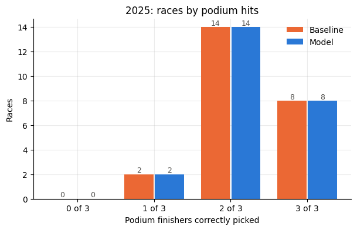
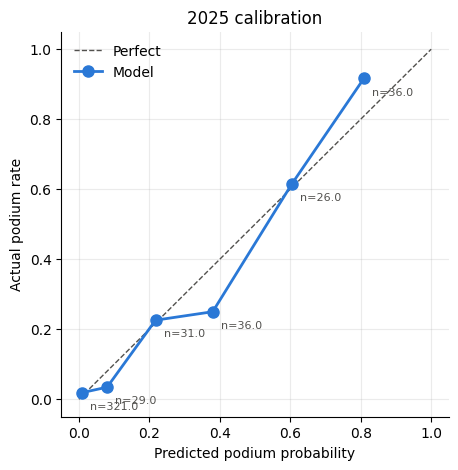
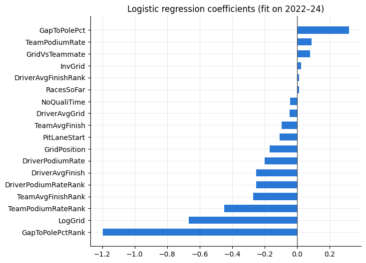

# Formula 1 Podium Prediction

Predict which drivers finish on the podium (P1–P3), using only information available **after qualifying and before the race**.

**Result:** on the untouched 2025 season, a logistic regression ties the grid top-3 baseline at **2.25 of 3 podium finishers per race**. Its probabilities are well calibrated. The starting grid turns out to be very hard to beat, and this project shows why.

## Problem

| | |
|---|---|
| Target | Podium yes/no per driver per race, as a probability |
| Prediction time | After qualifying, before the race |
| Inputs | Official grid (penalties included), qualifying results, earlier races only |
| Seasons | 2022–2025 (one technical rules era) |
| Split (by time) | Train 2022–23 · Validate 2024 · **Test 2025, scored once** |
| Baseline | The top 3 on the grid finish on the podium |
| Metrics | Podium hits per race (top 3 by probability vs actual, out of 3), Brier score |

## Results

| | 2024 validation hits | 2024 Brier | **2025 test hits** | **2025 Brier** |
|---|---|---|---|---|
| Baseline (grid top 3) | 2.00 | 0.0699 | 2.25 | 0.0591 |
| Logistic regression (final) | 2.04 | 0.0675 | 2.25 | 0.0593 |
| Gradient boosting | 1.92 | 0.0708 | not run | not run |



**What I learned**
- **The grid is a very strong baseline.** In 2025, 54 of 72 podium finishers started in the top 3. The model beat the grid in 3 races and lost in 3.
- **The 2024 validation gain was noise.** The model's edge there was one extra correct pick in 24 races, and it didn't carry over to 2025. Locking the test set until the end is what made that visible.
- **The probabilities are trustworthy.** Predicted rates track actual podium rates (below), which is useful even when the top-3 picks match the grid.
- **Qualifying pace beats grid slot.** The strongest feature is the driver's gap-to-pole rank within the race. It sees through grid penalties.
- **Nothing pre-race can see the remaining misses:** DNFs and disqualifications (Norris at Zandvoort and Las Vegas), and drives from P17–P19 to the podium (Verstappen in Brazil, Antonelli in Las Vegas, Hülkenberg at Silverstone).

<p>


</p>

## Features

All features are known before the race starts.

| Group | Features |
|---|---|
| Qualifying / grid | Grid position, log and inverse grid, pit-lane start, gap to pole (%), no-time flag, grid vs teammate |
| Driver form (last 5 races) | Podium rate, average finish, average grid, races so far |
| Team form (last 5 races) | Podium rate, average finish |
| Within-race ranks | Rank of form and qualifying pace among that race's field |

**Leakage protection**
- Every history feature uses `shift(1)`, so a race never sees its own result.
- An automated check scrambles one race's results and asserts that race's features don't change (`src/features.py`, `check_no_leakage`).
- There are no full-season aggregates and no random splits. Imputation and the baseline lookup are fit on training data only.

## Project structure

```text
├── notebooks/
│   ├── 01_data_collection.ipynb   FastF1 → one row per driver per race
│   ├── 02_features.ipynb          pre-race features + leakage test
│   ├── 03_baseline_split.ipynb    time split, grid baseline, metrics
│   ├── 04_models.ipynb            logistic regression, gradient boosting, fixes
│   ├── 05_results.ipynb           2025 test, calibration, error analysis
│   └── 06_predict_race.ipynb      predict any race by year + name, season backtest
├── src/
│   ├── data_collection.py
│   ├── features.py
│   ├── evaluate.py
│   ├── models.py
│   └── predict.py
├── data/            cache/ (FastF1), raw/, processed/
├── models/          saved final model (podium_logreg.joblib)
├── docs/            charts used in this README
├── reports/         research report: how others predict F1 results
└── research_notes/  source notes behind the report
```

## Run it

```bash
pip install -r requirements.txt
```
```bash
python -m src.data_collection
```
```bash
python -m src.features
```
```bash
python -m src.models
```

Data collection pulls about 90 races from FastF1, which allows 500 API calls an hour. If you hit `RateLimitExceededError`, wait an hour and re-run. Finished seasons are saved to `data/raw/seasons/` and cached sessions are reused, so each run picks up where the last one stopped.

## Final model

`models/podium_logreg.joblib` is the final model: logistic regression (C=0.3) on 18 pre-race features, trained on all 2022–2025 races (1,836 driver-race rows). It's saved with its feature list, training seasons and 2025 test scores.

```bash
python -m src.models --save
```

```python
from src.models import load_final_model

bundle = load_final_model()
probs = bundle["model"].predict_proba(features[bundle["features"]])[:, 1]
```

`src.predict` retrains on every race before the one you ask for, so each prediction uses the latest results. The saved model is a fixed snapshot of the evaluated setup.

## Predict a race

Run after qualifying. Give the year and the race, as a name (fuzzy matched) or a round number:

```bash
python -m src.predict 2026 Mexico
```

It trains on every race before the one you name, from 2022 up to the current season (fetched up to today), and prints each driver's podium probability. For a race that has already run, it also prints the actual podium. If grid penalties are announced, pass the official grid with `predict(year, race, grid={...})` or the `GRID` cell in notebook 06; otherwise qualifying order is used.

Example: the 2026 United States GP

| | P1 | P2 | P3 |
|---|---|---|---|
| Predicted | Antonelli 87% | Verstappen 72% | Hadjar 48% |
| Actual | Antonelli | Leclerc | Verstappen |

**2026 so far (rounds 1–18):** 1.89 podium hits per race for both the model and the grid, the same tie as the 2025 test. 2026 is a new rules era, but the model still transfers: its rank and form features are relative to the field, and with a 5-race window, form mid-season comes only from 2026.

## Data notes

- Grid position 0 (pit-lane start) is mapped to the back of the grid, with a `PitLaneStart` flag.
- Drivers who withdrew before the start are removed (Schumacher, Saudi Arabia 2022; Stroll, Singapore 2023).
- Team renames are unified (AlphaTauri → RB, Alfa Romeo → Sauber, and so on) so team form carries across seasons.
- FastF1 has no qualifying lap times for Miami 2025, so gap to pole is missing for that race.
- 2026 adds Cadillac (22 cars), and Sauber is now Audi. Both are treated as new teams.

## How others do it, and what I tried

I reviewed open-source projects, academic papers and industry approaches. The full write-up is in `reports/F1 podium prediction approaches.md`.

- **Most public projects report "85–91% accuracy".** That is per-driver accuracy, and predicting "no podium" for everyone already scores about 85%. Several of them also use random splits or features that leak future races.
- **Academic models rank the whole field jointly** (Plackett-Luce / rank-ordered logit), with separate driver and car effects. The car explains about 86–88% of results.
- **The most rigorous public backtest** beats a grid baseline mainly on probability quality, not on picks. An earlier version of it lost to "pole wins".

Following that, I tested four ideas: a joint Plackett-Luce model, rescaling each race's probabilities to sum to 3, track overtaking difficulty, and team/driver race-vs-qualifying pace plus DNF rate. **None beat the grid.** The extra features overfit 44 training races, and on 2026 rounds 1–18, a new rules era, the plain grid baseline won outright (Brier 0.0613 vs 0.0641–0.0648). Per-grid-slot podium rates carry over to new rules; form and track history from older seasons don't.

**Conclusion:** with only post-qualifying information, the starting grid is close to the best you can do. What's left is in-race chaos: DNFs, safety cars, strategy and weather.

## Next ideas

- Live, in-race updates (lap-by-lap win probability), where information beyond the grid actually exists
- Weather forecast for race day (wet races cause the biggest surprises)
- Odds from betting markets as a stronger benchmark than the grid

## Tech

Python · FastF1 · pandas · scikit-learn · matplotlib · Jupyter
